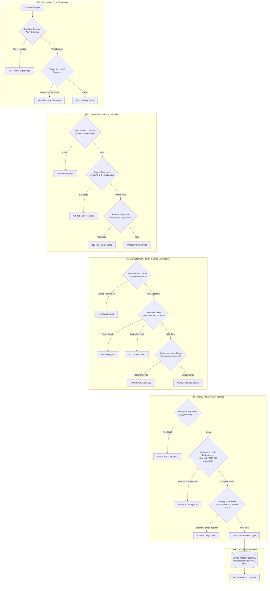

# Issue: User Improvement Proposal Box (Buzón de Propuestas de Mejora)

**Target Roadmap Package:** `E8.5` (Extension of Epic E8: Feedback & User Intake)  
**Security Level:** High / Defense-in-Depth (OWASP ASVS Level 2, NIST SP 800-95, GDPR/LOPDGDD Zero-PII)  
**Selected Storage Backend:** **Local SQLite Engine (`SQLiteProposalRepository`)** (Confirmed by project owner: zero recurring cost, zero external cloud infra, < 5 MB RAM impact)  
**Status:** Ready for Dispatch / Architecture & Threat Model Reviewed  
**Language Boundary:** Public interface in Spanish (`es-ES`); codebase, schemas, and technical documentation in clear controlled English.

---

## 1. Summary and Goal

We need an anonymous, rock-solid "Improvement Proposal Box" (letterbox / *buzón de propuestas de mejora*) where citizens and visitors can answer:  
**"¿Qué te gustaría ver diferente en esta aplicación?"** (*What would you like to see different in this app?*).

Because this feature introduces an untrusted public write endpoint into an otherwise static architecture, **it must meet rigorous industry security standards** (OWASP Top 10, CWE mitigation, RFC 9110/9116) and actively **prevent malicious users from flooding multiple submissions** or bypassing client-side limitations.

The confirmed storage backend is **Local SQLite** in WAL mode on a Docker persistent volume (`/data/feedback.db`). The implementation must follow a clean repository port (`ProposalRepository`), keeping domain logic decoupled and testable with in-memory SQLite fixtures.

Maintainers will periodically review the backlog via an offline CLI triage tool to trim noise, spambots, and fake requests, prioritize genuine improvements, and convert high-value proposals into GitHub issues or roadmap work packages.

---

## 2. Technical Context & Constraints

1. **Origin Infrastructure:**
   - Static Python 3.14 site served by Nginx inside Docker on an IONOS Ubuntu VPS (1 vCPU, 1 GB RAM) behind Cloudflare Full SSL.
   - Cost ceiling: €50.00/month hard ceiling (budgeted ~€9–€15/month). Uncapped metered bandwidth services are forbidden.
   - Zero-tracking requirement: Nginx access logging is disabled on the origin to preserve user privacy for the upcoming political quiz (Epic E4).
2. **Selected Database Engine: Local SQLite:**
   - Single SQLite file on persistent Docker volume (`/data/feedback.db`).
   - Runs directly on the VPS host with zero external network overhead or third-party service fees.
   - Concurrency managed via WAL mode (`PRAGMA journal_mode=WAL; PRAGMA synchronous=NORMAL;`), providing sub-millisecond atomic writes with < 5 MB RAM footprint.
3. **Data Protection & Privacy (GDPR / LOPDGDD):**
   - Strictly zero personal identifiable information (PII). No accounts, no email addresses, no phone numbers, no tracking cookies.
   - Users are explicitly warned: *"Por favor, no incluyas datos personales ni información confidencial."*
   - Raw IP addresses must **never** be stored permanently in proposal records. Rate-limiting and deduplication use ephemeral or salted HMAC hashes. Automated scrubbing sanitizes accidental emails or phone numbers.

---

## 3. Threat Model & Multi-Tier Malicious User Defense

Malicious users will attempt to bypass client-side limits by scripting direct HTTP requests (`curl`, Python, bots), rotating residential proxies, hopping IPv6 subnets, or submitting slightly mutated strings.

To counter this, the architecture implements a **5-tier defense-in-depth pipeline**:



### Comprehensive Threat Defense Matrix

| Threat Vector & CWE | Malicious Mechanism | Industry-Standard Countermeasure |
|---|---|---|
| **Malicious Multiple Inputs (Sybil / Flooding)**<br>`CWE-799` | Script spamming thousands of requests by rotating IPs or clearing cookies | 1. **Cryptographic Token & Nonce:** Form issues an HMAC-SHA256 signed token. Must be used between 3s and 10min. Nonce consumed on submission (single-use; prevents replay attacks).<br>2. **Cloudflare Turnstile:** Invisible challenge verifying authentic browser execution; headless scripts cannot acquire a valid token.<br>3. **Subnet-Aggregated Rate Limiting:** Rate limit applied to IPv4 `/32` and IPv6 `/64` subnets (prevents IPv6 hopping). |
| **SQL Injection (SQLi)**<br>`CWE-89` | Malicious SQL fragments (`' OR '1'='1`, `UNION SELECT`) injected into proposal text | • 100% parameterized queries via DB-API / SQLite parameter binding (`cursor.execute("... VALUES (?, ?)", (id, text))`).<br>• Zero string formatting / raw SQL concatenation.<br>• Strict Pydantic typing (`str` only, rejecting object/operator injection). |
| **Stored XSS**<br>`CWE-79` | HTML/JavaScript payload (`<script>alert(1)</script>`, ``) stored to compromise maintainer browser | • Input sanitization: Strip null bytes (`\0`), control characters, and normalize Unicode (NFC).<br>• Zero HTML rendering: Proposal text is stored and treated strictly as an untrusted raw string.<br>• Triage CLI and UI render exclusively as plain text (`textContent` in DOM; escaped terminal output). Never parse as HTML or Markdown. |
| **Near-Duplicate Mutation Flooding**<br>`CWE-400` | Malicious actor submitting slightly mutated spam ("test 1", "test 2", "test 3") to bypass hash checks | • **Semantic Near-Duplicate Detection:** Beyond SHA-256, calculate a 64-bit SimHash / 3-gram character shingles. If similarity $> 0.85$ compared to submissions from the past 24 hours, automatically suppress or collapse. |
| **Spambots & Automated Scrapers**<br>`CWE-837` | Automated web bots traversing forms to post SEO spam or phishing links | • **Dual Honeypot Trap:** Invisible input field (`_hp_company`, `aria-hidden="true"`, `tabindex="-1"`). Real users never see or fill it; bots fill it automatically.<br>• Submissions with filled honeypot return silent `HTTP 201 Created` (so the bot believes it succeeded) but tag the record as `status: spam` for instant trimming. |
| **Memory / CPU Exhaustion (DoS)**<br>`CWE-400` | Sending multi-megabyte payloads or opening slow connections to crash the 1 GB VPS | • Nginx enforces `client_max_body_size 8k` and `client_body_buffer_size 8k` before body is passed to memory.<br>• Application field validation: Min 10 chars, Max 600 chars. Rejects oversized text immediately.<br>• Connection limit: `limit_conn perip 5`. |
| **Cross-Site Request Forgery (CSRF)**<br>`CWE-352` | Malicious third-party website submitting requests using the visitor's browser | • Enforce `Origin` and `Sec-Fetch-Site: same-origin`.<br>• Require custom request header: `X-Requested-With: Elections2026-Feedback`. Browsers refuse to attach custom headers cross-origin without CORS preflight. |
| **IP Spoofing**<br>`CWE-345` | Malicious user manipulating `X-Forwarded-For` headers to bypass rate limits | • Nginx configured with `set_real_ip_from` restricted strictly to verified Cloudflare IP ranges; uses `real_ip_header CF-Connecting-IP`. Custom `X-Forwarded-For` headers sent by clients are discarded. |
| **PII Contamination (GDPR/LOPDGDD)**<br>`CWE-359` | Submitter entering personal emails, names, or telephone numbers | • Clear Spanish warning in UI.<br>• Ingest pipeline runs regex scrubbing to detect and redact email patterns (`[a-zA-Z0-9_.+-]+@[a-zA-Z0-9-]+\.[a-zA-Z0-9-.]+`) and Spanish phone patterns (`(\+34|0034)?[6789]\d{8}`) prior to persistence. |

---

## 4. Local SQLite Persistence Specification

The owner selected **Local SQLite** as the persistence engine. It provides high durability, zero external dependencies, and atomic operations.

### 4.1 SQLite Schema & Connection Pragmas

```sql
-- Connection Initialization Pragmas
PRAGMA journal_mode = WAL;
PRAGMA synchronous = NORMAL;
PRAGMA foreign_keys = ON;
PRAGMA busy_timeout = 5000;

-- 1. Proposals Table
CREATE TABLE IF NOT EXISTS proposals (
    id TEXT PRIMARY KEY,
    created_at TEXT NOT NULL,           -- ISO-8601 UTC
    category TEXT NOT NULL DEFAULT 'general',
    text TEXT NOT NULL,
    status TEXT NOT NULL DEFAULT 'pending', -- pending, spam, rejected, considered, actioned
    char_count INTEGER NOT NULL,
    completion_time_ms INTEGER NOT NULL,
    content_hash TEXT NOT NULL,         -- SHA-256 of normalized text
    simhash TEXT NOT NULL,              -- 64-bit SimHash hex string
    subnet_hash TEXT NOT NULL,          -- Salted hash of client /32 (IPv4) or /64 (IPv6)
    reviewer_notes TEXT,
    action_ticket TEXT
);

CREATE INDEX IF NOT EXISTS idx_proposals_status ON proposals(status);
CREATE INDEX IF NOT EXISTS idx_proposals_created_at ON proposals(created_at);
CREATE INDEX IF NOT EXISTS idx_proposals_content_hash ON proposals(content_hash);
CREATE INDEX IF NOT EXISTS idx_proposals_simhash ON proposals(simhash);

-- 2. Consumed Nonces Table (Anti-Replay Protection)
CREATE TABLE IF NOT EXISTS consumed_tokens (
    nonce TEXT PRIMARY KEY,
    consumed_at TEXT NOT NULL,
    expires_at INTEGER NOT NULL          -- Unix epoch seconds
);

CREATE INDEX IF NOT EXISTS idx_consumed_tokens_expires ON consumed_tokens(expires_at);

-- 3. Subnet Rate Limiting Table
CREATE TABLE IF NOT EXISTS rate_limits (
    subnet_hash TEXT NOT NULL,
    window_start INTEGER NOT NULL,       -- Unix epoch bucket (e.g. 1-hour window)
    request_count INTEGER NOT NULL DEFAULT 1,
    PRIMARY KEY (subnet_hash, window_start)
);
```

### 4.2 Storage Port Interface (`ProposalRepository`)
```python
from typing import Protocol, Optional
from dataclasses import dataclass

class ProposalRepository(Protocol):
    """Abstract interface decoupling domain logic from physical storage."""

    def save_proposal(self, proposal: "ProposalCreate") -> "ProposalRecord":
        """Persist a new proposal record via parameterized SQL."""
        ...

    def list_proposals(
        self,
        status: Optional[str] = "pending",
        category: Optional[str] = None,
        limit: int = 50,
        offset: int = 0
    ) -> list["ProposalRecord"]:
        """Retrieve proposals for maintainer triage."""
        ...

    def update_status(
        self,
        proposal_id: str,
        new_status: str,
        reviewer_notes: Optional[str] = None,
        action_ticket: Optional[str] = None
    ) -> "ProposalRecord":
        """Update proposal lifecycle (pending -> considered | spam | rejected | actioned)."""
        ...

    def is_duplicate(self, content_hash: str, simhash: str, window_seconds: int = 86400) -> bool:
        """Check if identical or near-identical content was submitted recently."""
        ...

    def is_rate_limited(self, subnet_hash: str, max_requests: int = 3, window_seconds: int = 3600) -> bool:
        """Check if client subnet hash exceeded submission rate."""
        ...

    def is_token_consumed(self, nonce: str) -> bool:
        """Verify if a single-use token nonce has already been consumed."""
        ...

    def mark_token_consumed(self, nonce: str, ttl_seconds: int = 600) -> None:
        """Record a single-use nonce as consumed."""
        ...

    def prune_expired(self) -> int:
        """Delete expired nonces and stale rate limit rows."""
        ...
```

---

## 5. User Experience (UX) Specification

### 5.1 UX Principles
- **Language:** Spanish (`es-ES`) strictly for all customer-facing text, notifications, and labels.
- **Mobile-first:** Optimized for 360–430 CSS px viewport; touch targets $\ge 44 \times 44$ CSS px.
- **Accessibility:** WCAG 2.2 AA compliant. Proper ARIA attributes, semantic labels, keyboard navigable, screen-reader announced status updates (`aria-live="polite"`).
- **Non-intrusive:** Does not interrupt the comparison reading flow; accessible via a discreet footer trigger and dedicated `/propuestas/` route.

### 5.2 Entry Points
1. **Site Footer Link:**
   - Text: `¿Qué mejorarías en esta web? Buzón de propuestas`
   - Location: In the standard Spanish footer alongside methodology and sources links.
2. **Dedicated Route (`/propuestas/`):**
   - Enables direct sharing, bookmarks, and full functionality even without JavaScript enabled (progressive enhancement).

### 5.3 Form Layout & Copy (Spanish)

```text
+-------------------------------------------------------------+
|  Buzón de propuestas y sugerencias                          |
|  ¿Qué te gustaría ver diferente en esta aplicación?        |
+-------------------------------------------------------------+
|  Tu opinión nos ayuda a hacer esta herramienta más útil y   |
|  clara. Leemos todas las propuestas para priorizar cambios. |
|  Aviso: Por favor, no introduzcas datos personales.         |
+-------------------------------------------------------------+
|  Categoría (opcional):                                      |
|  ( ) General  ( ) Comparador  ( ) Fuentes  ( ) Diseño       |
+-------------------------------------------------------------+
|  Tu propuesta de mejora:                                    |
|  +-------------------------------------------------------+  |
|  | Describe qué cambio o función propones...             |  |
|  |                                                       |  |
|  +-------------------------------------------------------+  |
|  45 / 600 caracteres (mínimo 10)                            |
+-------------------------------------------------------------+
|  [ Cancelar ]                     [ Enviar propuesta (->) ] |
+-------------------------------------------------------------+
```

### 5.4 Form State Machine & User Feedback

1. **Idle / Empty:**
   - Textarea empty. Submit button disabled (`disabled aria-disabled="true"`). Character counter shows `0 / 600`.
2. **Typing (< 10 chars):**
   - Counter updates in real-time. Validation helper: *"Escribe al menos 10 caracteres para enviar tu propuesta."*
3. **Valid (10–600 chars):**
   - Submit button enabled with clear contrast.
4. **Submitting:**
   - Submit button disabled, shows spinner or text: *"Enviando propuesta..."*.
   - Input field set to `readonly`.
5. **Success (HTTP 201):**
   - Form container transitions to success card with polite screen-reader announcement:
     *"¡Muchas gracias! Tu propuesta ha quedado registrada en nuestro buzón para revisión."*
   - A button `[Volver al comparador]` lets the user return to their previous view.
   - Cooldown timer recorded in `localStorage`.
6. **Rate-limited / Cooldown Active:**
   - If user visits within 5 minutes of submitting:
     *"Ya has enviado una propuesta recientemente. Por favor, espera unos minutos antes de enviar otra sugerencia."*
7. **Error / Network Failure (HTTP 4xx / 5xx):**
   - Red banner: *"No se ha podido enviar la propuesta en este momento. Por favor, inténtalo de nuevo más tarde."*
   - User input is **preserved** in the textarea so they do not lose their drafted text.

---

## 6. Maintainer Triage & Moderation Workflow

The goal is to easily "trim the shitty ones, the fake ones, and attack the proper ones" without needing a complex administrative dashboard.

### 6.1 Lifecycle States
- `pending`: Newly ingested proposal awaiting review.
- `spam`: Identified as bot noise, commercial spam, or abusive gibberish (trimmed).
- `rejected`: Out of scope (e.g. asking for vote recommendations, party defamation).
- `considered`: Legitimate, constructive proposal under discussion.
- `actioned`: Converted into a roadmap work package or GitHub issue.

### 6.2 Pre-Triage Heuristic Rules (Automated Filtering)
The ingestion service automatically tags submissions before human triage:
- If `honeypot_field` is filled $\rightarrow$ auto-mark `spam`.
- If `completion_time_ms < 3000` $\rightarrow$ flag as `suspected_bot`.
- If `simhash` matches an existing submission $\ge 85\%$ $\rightarrow$ flag as `near_duplicate`.
- If text entropy is low (e.g., character repetition $> 4$, no whitespace in $> 30$ chars) $\rightarrow$ flag as `gibberish`.
- If contains `http://` or `https://` $\rightarrow$ flag for URL safety review.

### 6.3 Triage CLI Tool (`tools/feedback_triage.py`)
Maintainers run an offline triage script periodically:
```bash
# View pending proposals
python -m tools.feedback_triage list --status pending

# Interactive triage session
python -m tools.feedback_triage review
# Prompt:
# [ID: 104] (comparator): "¿Podríais añadir una opción para comparar tres partidos a la vez?"
# Actions: [c]onsider/accept | [s]pam/trim | [r]eject | [g]ithub issue snippet | [n]ext?
```

---

## 7. Acceptance Criteria for Implementing Agent

When an agent is dispatched to implement package `E8.5`, it must satisfy the following:

- [ ] **Data Model & Schema:** Pydantic models for `ProposalCreate`, `ProposalRecord`, and `ProposalReview` with field limits (10–600 chars), Unicode NFC normalization, and PII pattern redaction.
- [ ] **SQLite Implementation:** `SQLiteProposalRepository` implementing `ProposalRepository` Protocol with parameterized queries, WAL mode pragmas, and atomic transactions.
- [ ] **Malicious Multiple-Input Prevention Tests:**
  - [ ] Single-use token: Replaying the same `X-Proposal-Token` twice must fail or deduplicate.
  - [ ] Minimum completion time: Submissions submitted $< 3.0$ seconds from token issue are rejected or flagged as bot activity.
  - [ ] Subnet rate limit: Rapid requests from the same `/32` (IPv4) or `/64` (IPv6) return HTTP 429.
  - [ ] Near-duplicate suppression: Mutated spam strings with SimHash similarity $> 0.85$ are flagged or collapsed.
- [ ] **Standard Security Tests:**
  - [ ] SQL injection attempts (e.g. `'; DROP TABLE proposals; --`) stored literally without syntax corruption or execution.
  - [ ] Honeypot submission returns silent HTTP 201 but stores record as `status: spam`.
  - [ ] Submissions over 600 characters or under 10 characters are rejected with HTTP 422.
  - [ ] Stored XSS tests confirm `<script>` and `<iframe>` strings are never executed or rendered as raw HTML.
  - [ ] Request body size $> 8$ KB rejected by Nginx with HTTP 413.
  - [ ] Custom header `X-Requested-With` enforced to prevent cross-origin CSRF.
- [ ] **Mobile UX & UI:**
  - [ ] Spanish text dictionary entries added to `src/` string catalogs.
  - [ ] Mobile-tested at 360 px, 390 px, and 430 px viewports with $\ge 44$ px touch targets.
  - [ ] Accessible form controls with visible focus indicators and `aria-live` state announcements.
- [ ] **Triage Tooling:** CLI triage utility in `tools/` capable of listing, tagging (`spam`/`considered`), and exporting proposals.
- [ ] **Documentation:** Update `docs/ARCHITECTURE.md` and `docs/SECURITY.md` with the new write boundary, rate-limit settings, and privacy guarantees.

---

## 8. Agent Dispatch Instruction Prompt

To dispatch an implementation agent in a new branch, use the following prompt:

```text
Implement package E8.5: User Improvement Proposal Box (Buzón de Propuestas de Mejora) according to the specifications in docs/issues/ISSUE-IMPROVEMENT-PROPOSAL-BOX.md.

Key requirements:
1. Use Local SQLite in WAL mode on /data/feedback.db as the persistence repository (SQLiteProposalRepository).
2. Adhere strictly to the OWASP ASVS Level 2 threat model in section 3 (parameterized queries, single-use anti-replay tokens, honeypot trap, /32 and /64 subnet rate limiting, SimHash near-duplicate detection, and PII regex scrubbing).
3. Build the mobile-first Spanish UI (360-430 px viewports, >=44px touch targets) with accessible state transitions.
4. Build the offline maintainer triage CLI in tools/feedback_triage.py.
5. Provide comprehensive unit and security integration tests in tests/.
6. Work in a feature branch (e.g., feat/proposal-letterbox-sqlite). Conventional commit: feat(feedback): implement improvement proposal box with sqlite backend.
```
