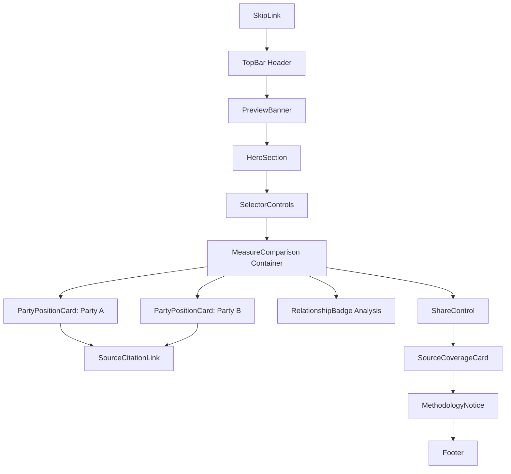

# Elecciones 2026 — Accessible Component Plan and Mobile Wireframes

**Package:** E2.1  
**Status:** Approved design baseline  
**Document language:** Controlled English (technical plan), Spanish (public UI copy)  
**Standard:** WCAG 2.2 Level AA compliant  
**Target Viewports:** 360 CSS px (compact mobile), 390 CSS px (baseline mobile), 430 CSS px (large mobile)

---

## 1. Executive Summary and Scope

This document specifies the accessible component plan and mobile wireframes for the Spanish general-election programme comparator ("Elecciones 2026", working title).

It translates the visual concept approved in [the Stitch review](../docs/STITCH-REVIEW.md) into an auditable, accessible, and static-ready design system.

### 1.1 Architectural and Editorial Principles

1. **Mobile-First Single-Column Flow:** The baseline viewport is a 390 CSS px smartphone. Layouts adapt cleanly to 360 px and 430 px without horizontal scrolling, clipping, or multi-column crushing.
2. **Comparison Grouped by Measure:** Party positions are displayed stacked under the same policy measure. Tabbed switching that conceals one party at a time is rejected as the default.
3. **Factual Provenance over Fake Verification:** Every position links to an immutable source document, version, and page or section. Deceptive claims such as "100% verificado" are strictly prohibited.
4. **Explicit Negative States:** Absence of a statement in a programme is rendered explicitly as `no consta` ("No consta posición en el programa analizado") and never conflated with political opposition or negative scoring.
5. **Civic Neutrality:** No political party colors, logos, ranking scores, or voting recommendations exist. Neutral color tokens (soft teal for Party A, soft lavender for Party B) provide distinction without bias.
6. **Zero External CDN Dependencies:** Local design tokens ([tokens.json](tokens/tokens.json), [tokens.css](tokens/tokens.css)) and system font stacks replace Tailwind CDN and Google Fonts.
7. **Strict Non-Goals for the MVP:**
   - **NO Profile UI:** No user accounts, login buttons, avatars, or visitor preference tracking.
   - **NO Interactive Report Form:** Static explanatory notice only. A write API is deferred to a separate post-MVP package.
   - **NO Dynamic AI Clustering:** Pre-computed, editorially approved comparisons only.

---

## 2. Local Design Tokens Integration

All components consume local CSS custom properties declared in `site/tokens/tokens.css` (backed by machine-readable schema in `site/tokens/tokens.json`).

| Category | Token Prefix | Key Values | WCAG 2.2 AA Compliance |
|---|---|---|---|
| Canvas Background | `--color-bg-canvas` | `#f8f9f7` | Soft off-white, reduces eye strain |
| Surface Background | `--color-bg-surface` | `#ffffff` | Clean card background |
| Primary Body Text | `--color-text-primary` | `#14253a` | 14.67:1 on canvas, 15.49:1 on surface |
| Secondary Text | `--color-text-secondary` | `#526675` | 5.66:1 on canvas, 5.97:1 on surface |
| Primary Action | `--color-bg-primary` | `#164f67` | 8.94:1 with white text (`--color-text-inverse`) |
| Party A Identifier | `--color-party-a-bg` / `text` | `#d2eaf0` / `#134e67` | 7.25:1 contrast, neutral teal tone |
| Party B Identifier | `--color-party-b-bg` / `text` | `#e6e5f2` / `#3d3765` | 8.72:1 contrast, neutral lavender tone |
| Focus Ring | `--focus-ring` | `2px white, 4px #164f67` | Non-text contrast >= 3:1 |
| Touch Target Minimum | `--touch-target-min` | `44px` | Strict adherence to WCAG 2.5.5 / 2.5.8 |
| Touch Target Default | `--touch-target-comfortable` | `48px` | Default height for interactive form controls |
| Font Stack | `--font-family-sans` | Local system fonts | Zero network round-trips or font privacy leaks |

---

## 3. Component Inventory and Specification

The MVP experience consists of twelve core components across four destinations: **Inicio (Home)**, **Selección (Selector)**, **Comparador (Comparison grouped by measure)**, and **Metodología y Fuentes (Sources & Method)**.



### Component 1: SkipLink (`#skip-link`)

- **Purpose:** Allows keyboard and screen reader users to bypass top navigation and jump directly to `#contenido`.
- **HTML Structure:**
  ```html
  <a class="skip-link" href="#contenido">Saltar al contenido principal</a>
  ```
- **States:**
  - *Idle:* Visually hidden offscreen (`position: absolute; left: -9999px; top: auto; width: 1px; height: 1px; overflow: hidden;`).
  - *Focus-visible:* Displayed at viewport top-left (`left: 1rem; top: 1rem; z-index: 1000; min-height: 44px; padding: 0.75rem 1rem; background: var(--color-bg-surface); color: var(--color-text-primary); border: 2px solid var(--color-bg-primary); box-shadow: var(--shadow-md);`).

---

### Component 2: TopBar Header (`.topbar`)

- **Purpose:** Identifies the project and provides fast navigation to main destinations.
- **Rules:** **STRICTLY NO PROFILE UI**. No avatar, account menu, login button, or personal data controls.
- **HTML Structure:**
  ```html
  <header class="topbar" role="banner">
    <div class="topbar-inner">
      <a class="brand" href="/" aria-label="Elecciones 2026 - Inicio">
        <span class="brand-mark" aria-hidden="true">◧</span>
        <span class="brand-text">Elecciones<span class="brand-year">2026</span></span>
      </a>
      <nav class="nav-links" aria-label="Navegación principal">
        <a class="nav-link" href="#comparador">Comparador</a>
        <a class="nav-link" href="#metodo">Metodología</a>
        <a class="nav-link" href="#fuentes">Fuentes</a>
      </nav>
    </div>
  </header>
  ```
- **Touch & Accessibility:**
  - Navigation links have `min-height: 44px` and `min-width: 44px` clickable area.
  - `:focus-visible` renders a 2px solid outline with 2px offset (`outline: 2px solid var(--color-border-focus); outline-offset: 2px;`).
- **States:**
  - *Default:* Calm neutral background with bottom border `--color-border-subtle`.
  - *Link Hover:* Underline decoration, text color darkened.
  - *Link Active:* Slight background tint `--color-bg-surface-subtle`.

---

### Component 3: PreviewBanner (`.preview-banner`)

- **Purpose:** Prominently warns readers that data is for preview, test, or prototype purposes and must not be published as official election guidance.
- **HTML Structure:**
  ```html
  <aside class="preview-banner" role="status" aria-label="Aviso de prototipo">
    <span class="preview-badge">VISTA PREVIA</span>
    <span class="preview-text">Datos de prueba · No publicar como información electoral definitiva</span>
  </aside>
  ```
- **Accessibility:** High-contrast text (11.12:1 ratio) with `role="status"` so assistive technology announces it without interrupting primary flow.

---

### Component 4: HeroSection (`.hero`)

- **Purpose:** Communicates purpose, election date (29 Nov 2026), editorial policy (no voting recommendation), and primary action.
- **HTML Structure:**
  ```html
  <section class="hero" aria-labelledby="hero-title">
    <p class="hero-eyebrow">ELECCIONES GENERALES · 29 NOV 2026</p>
    <h1 id="hero-title" class="hero-title">Los programas,<br><span class="hero-em">puestos en claro.</span></h1>
    <p class="hero-intro">Compara propuestas políticas sobre temas clave. Cada posición enlaza al programa original y su página exacta. Sin recomendaciones de voto.</p>
    <div class="hero-actions">
      <a class="btn-primary" href="#comparador">
        <span>Explorar comparador</span>
        <span aria-hidden="true">→</span>
      </a>
    </div>
  </section>
  ```
- **States for `.btn-primary`:**
  - *Default:* Deep teal background (`--color-bg-primary`), white text, `min-height: 48px`, `border-radius: var(--radius-md)`.
  - *Hover:* Background darkens to `--color-bg-primary-hover` (`#0e394e`).
  - *Active:* Scaled 0.98 for subtle haptic feedback.
  - *Focus-visible:* Outline ring with 2px offset.
  - *Disabled:* Opacity 0.5, cursor `not-allowed`.

---

### Component 5: SelectorControls (`.controls-group`)

- **Purpose:** Mobile-friendly form controls to choose 1 topic (out of 8 taxonomy topics) and exactly 2 parties.
- **HTML Structure:**
  ```html
  <section class="controls-section" aria-labelledby="controls-heading">
    <h2 id="controls-heading" class="sr-only">Selección de tema y candidaturas</h2>
    <form class="controls-form" role="search" aria-label="Filtro de comparación">
      <div class="control-field">
        <label for="topic-select" class="control-label">Tema de comparación</label>
        <div class="select-wrapper">
          <select id="topic-select" name="topic" class="control-select">
            <option value="housing">Vivienda</option>
            <option value="education">Educación</option>
            <option value="health-social-services">Sanidad y servicios sociales</option>
            <option value="economy-work-tax">Economía, empleo y tributos</option>
            <option value="immigration">Inmigración</option>
            <option value="foreign-policy-eu">Política exterior y UE</option>
            <option value="climate-energy">Clima y energía</option>
            <option value="institutions-rights">Instituciones y derechos</option>
          </select>
        </div>
      </div>
      <div class="control-field">
        <label for="party-a-select" class="control-label">Primer partido</label>
        <div class="select-wrapper">
          <select id="party-a-select" name="partyA" class="control-select">
            <option value="party-a">Partido A (ficticio)</option>
          </select>
        </div>
      </div>
      <div class="control-field">
        <label for="party-b-select" class="control-label">Segundo partido</label>
        <div class="select-wrapper">
          <select id="party-b-select" name="partyB" class="control-select">
            <option value="party-b">Partido B (ficticio)</option>
          </select>
        </div>
      </div>
    </form>
  </section>
  ```
- **Accessibility & Mobile Touch:**
  - `<select>` inputs have `min-height: 48px`, font size `1rem` (16px) to strictly prevent iOS automatic viewport zoom on focus.
  - Labels are programmatically connected via `for` and `id`.
  - Stacked vertically on viewports < 760px to prevent narrow-field clipping on 360/390 px phones.
- **States:**
  - *Default:* White background, border `--color-border-default`.
  - *Focus-visible:* Border `--color-border-focus`, box-shadow focus ring.
  - *Disabled:* Background `--color-bg-surface-subtle`, cursor `not-allowed`.
  - *Invalid (same party selected twice):* Border `2px solid var(--color-status-missing-text)`, aria-invalid="true" with visible error message.

---

### Component 6: MeasureComparison Container (`.measure-comparison`)

- **Purpose:** Groups both party positions under one concrete measure. Avoids tab switching.
- **Structure:**
  1. Measure Title (`<h3>` with measure identifier and operational name).
  2. Measure neutral summary paragraph.
  3. Stacked Party Position Cards (Party A, then Party B).
  4. Comparative analysis callout (`RelationshipBadge`).
- **Fake Verification Prohibition:** No "100% verificado" or deceptive verification marks. The header indicates review status factually: "Revisión editorial completada el [fecha]".

---

### Component 7: PartyPositionCard (`.party-card`)

- **Purpose:** Presents one party's evaluated proposal for the given measure.
- **HTML Structure (Normal Position):**
  ```html
  <article class="party-card party-card-a" aria-labelledby="card-a-title">
    <div class="party-card-header">
      <span class="party-pill party-pill-a" aria-hidden="true">A</span>
      <div class="party-card-meta">
        <h4 id="card-a-title" class="party-name">Partido A</h4>
        <span class="status-badge status-badge-official">Programa oficial</span>
      </div>
    </div>
    <div class="party-card-body">
      <p class="party-statement">Construcción de 50.000 viviendas públicas en régimen de alquiler asequible mediante colaboración público-privada.</p>
      <div class="party-caveat" role="note" aria-label="Matiz o condición">
        <strong>Condición registrada:</strong> Financiación supeditada a transferencias estatales y cofinanciación autonómica.
      </div>
    </div>
    <div class="party-card-footer">
      <a class="source-citation" href="https://example.org/programa.pdf#page=42" target="_blank" rel="noopener noreferrer">
        <span class="source-icon" aria-hidden="true">↗</span>
        <span class="source-citation-text">Programa 2023 · pág. 42, sección 3.1</span>
        <span class="sr-only">(se abre en una ventana nueva)</span>
      </a>
      <time class="source-date" datetime="2026-10-09">Rev. 09/10/2026</time>
    </div>
  </article>
  ```
- **HTML Structure (Missing Position State - `no consta`):**
  ```html
  <article class="party-card party-card-b party-card-missing" aria-labelledby="card-b-title">
    <div class="party-card-header">
      <span class="party-pill party-pill-b" aria-hidden="true">B</span>
      <div class="party-card-meta">
        <h4 id="card-b-title" class="party-name">Partido B</h4>
        <span class="status-badge status-badge-missing">No consta en el programa</span>
      </div>
    </div>
    <div class="party-card-body">
      <p class="party-statement party-statement-missing">El programa revisado no incluye una propuesta explícita sobre esta medida concreta.</p>
      <p class="missing-explanation">La ausencia de una medida en el programa no debe interpretarse como oposición ni como apoyo.</p>
    </div>
    <div class="party-card-footer">
      <span class="source-citation-text text-muted">Fuente analizada: Programa oficial v1.0</span>
      <time class="source-date" datetime="2026-10-09">Rev. 09/10/2026</time>
    </div>
  </article>
  ```
- **Touch & Accessibility:**
  - Source links have `min-height: 44px`, display `inline-flex`, align items center.
  - Screen reader text `(se abre en una ventana nueva)` attached to external source links.
  - Keyboard focus on source link shows prominent 2px outline.

---

### Component 8: RelationshipBadge (`.rel-badge`)

- **Purpose:** Classifies the evaluated relationship between two proposals. Never color-only: includes clear icon and explicit text.
- **Relationship States:**
  1. `agreement` ("Coincidencia en la medida"): `#134e67` on `#eaf2f3`. Icon: `✓`.
  2. `divergence` ("Diferencia en instrumento o alcance"): `#3d3765` on `#eeedf6`. Icon: `↔`.
  3. `qualification` ("Coincidencia parcial con matices"): `#6a5424` on `#fff7df`. Icon: `~`.
  4. `notFound` ("Sin posición comparable"): `#526675` on `#f0f4f6`. Icon: `—`.

---

### Component 9: StatusBadge (`.status-badge`)

- **Purpose:** Identifies the lifecycle state of a programme document.
- **States:**
  - `official`: "Programa oficial" (verified SHA-256).
  - `partial`: "Documento parcial" (preliminary advance).
  - `missing`: "Programa no disponible" (registered candidature, no source yet).
  - `announced`: "Anunciado" (pending document download).
  - `replaced`: "Versión sustituida" (superseded by newer version).

---

### Component 10: ShareControl (`.share-control`)

- **Purpose:** Neutral sharing of current comparison URL without tracking parameters or personal data.
- **Structure:**
  ```html
  <div class="share-container">
    <button type="button" class="btn-share" id="share-button" aria-haspopup="false">
      <span aria-hidden="true">🔗</span>
      <span>Compartir esta comparación</span>
    </button>
    <div id="share-feedback" class="sr-only" role="status" aria-live="polite"></div>
  </div>
  ```
- **Interaction Logic:**
  - Invokes `navigator.share` if supported on mobile HTTPS device.
  - Falls back to `navigator.clipboard.writeText(url)` on other devices, setting `#share-feedback` to "Enlace copiado al portapapeles".
  - Touch target: `min-height: 48px`, full width on mobile.

---

### Component 11: MethodologyNotice (`.method-notice`)

- **Purpose:** Summarizes methodology and explicitly states error reporting availability.
- **Prohibition:** **NO FAKE REPORT FORM**. Static text only:
  ```html
  <aside class="method-notice" aria-labelledby="method-notice-heading">
    <h3 id="method-notice-heading">Avisos y correcciones</h3>
    <p>Revisamos los programas mediante un criterio estricto de citas exactas. La función para avisar de errores estará disponible más adelante.</p>
  </aside>
  ```

---

### Component 12: Footer (`.footer`)

- **Purpose:** Civic metadata, neutrality declaration, and copyright.
- **Rules:** Clean static footer. **NO bottom app navigation bar with profile icons**.

---

## 4. Phone Wireframes (360, 390, 430 CSS px)

### 4.1 Viewport Dimension and Budget Matrix

| Dimension | 360 CSS px (Compact) | 390 CSS px (Baseline) | 430 CSS px (Large Phone) |
|---|---|---|---|
| **Typical Devices** | iPhone SE, Galaxy A-series | iPhone 12/13/14/15/16 | iPhone Plus / Pro Max |
| **Page Margins** | `16px` (1rem) each side | `16px` (1rem) each side | `20px` (1.25rem) each side |
| **Usable Content Width** | `328px` | `358px` | `390px` |
| **Layout Strategy** | Strictly stacked 1-column | Strictly stacked 1-column | Strictly stacked 1-column |
| **Select Controls** | Full width (100% = 328px) | Full width (100% = 358px) | Full width (100% = 390px) |
| **Card Padding** | `16px` (`--space-4`) | `20px` (`--space-5`) | `24px` (`--space-6`) |
| **Minimum Touch Target** | `44px` height | `44px` height | `44px` height |
| **Touch Target Gap** | `8px` (`--space-2`) | `8px` (`--space-2`) | `12px` (`--space-3`) |
| **Typography Scale** | Hero: `2.25rem`, Body: `1rem` | Hero: `2.75rem`, Body: `1rem` | Hero: `3.0rem`, Body: `1.05rem` |

---

### 4.2 Wireframe 1: Home and Selection View (360 px vs 390 px vs 430 px)

#### 360 CSS px Frame (Width: 360px, Content: 328px)
```text
+------------------------------------+ (360px)
|  [Saltar al contenido] (oculto)    |
|====================================|
| VISTA PREVIA · DATOS FICTICIOS     | (min-h: 36px)
|------------------------------------|
| ◧ Elecciones 2026                  | (min-h: 44px)
| [Comparar]  [Método]  [Fuentes]    | (tap targets >= 44px)
|------------------------------------|
| ELECCIONES GENERALES · 29 NOV 2026 |
|                                    |
| Los programas,                     |
| puestos en claro.                  | (h1: 2.25rem)
|                                    |
| Compara propuestas políticas sobre |
| los temas que te importan. Cada    |
| posición enlaza a su fuente.       |
|                                    |
| +--------------------------------+ |
| | Explorar comparador         -> | | (h: 48px, w: 100%)
| +--------------------------------+ |
|                                    |
| +--------------------------------+ |
| | ! Aviso: «Partido A» y         | |
| |   «Partido B» son ejemplos     | | (notice box)
| +--------------------------------+ |
|                                    |
| 01 / SELECCIONAR                   |
|                                    |
| Tema                               |
| +--------------------------------+ |
| | Vivienda                     v | | (h: 48px, w: 100%)
| +--------------------------------+ |
|                                    |
| Primer partido                     |
| +--------------------------------+ |
| | Partido A (ficticio)         v | | (h: 48px, w: 100%)
| +--------------------------------+ |
|                                    |
| Segundo partido                    |
| +--------------------------------+ |
| | Partido B (ficticio)         v | | (h: 48px, w: 100%)
| +--------------------------------+ |
+------------------------------------+
```

#### 390 CSS px Frame (Baseline, Width: 390px, Content: 358px)
```text
+----------------------------------------+ (390px)
| VISTA PREVIA · DATOS DE PRUEBA         | (role="status")
|----------------------------------------|
| ◧ Elecciones 2026                      |
| [Comparador]   [Metodología]  [Fuentes]| (min-h: 44px)
|----------------------------------------|
| ELECCIONES GENERALES · 29 NOV 2026     |
|                                        |
| Los programas,                         |
| puestos en claro.                      | (h1: 2.75rem)
|                                        |
| Compara propuestas sobre los temas que |
| te importan. Cada posición enlaza a su |
| programa original. Sin recomendación.  |
|                                        |
| +------------------------------------+ |
| | Explorar comparador             -> | | (h: 48px, w: 100%)
| +------------------------------------+ |
|                                        |
| +------------------------------------+ |
| | ! Aviso de maqueta: Datos de prueba| | (notice box)
| +------------------------------------+ |
|                                        |
| 01 / FILTRO DE COMPARACIÓN             |
|                                        |
| Tema de análisis                       |
| +------------------------------------+ |
| | Vivienda                         v | | (h: 48px, w: 100%)
| +------------------------------------+ |
|                                        |
| Primer partido                         |
| +------------------------------------+ |
| | Partido A (ficticio)             v | | (h: 48px, w: 100%)
| +------------------------------------+ |
|                                        |
| Segundo partido                        |
| +------------------------------------+ |
| | Partido B (ficticio)             v | | (h: 48px, w: 100%)
| +------------------------------------+ |
+----------------------------------------+
```

#### 430 CSS px Frame (Large Phone, Width: 430px, Content: 390px)
```text
+--------------------------------------------+ (430px)
| VISTA PREVIA · DATOS FICTICIOS DE PRUEBA   |
|--------------------------------------------|
| ◧ Elecciones 2026                          |
| [Comparador]    [Metodología]    [Fuentes] | (min-h: 44px)
|--------------------------------------------|
| ELECCIONES GENERALES · 29 NOV 2026         |
|                                            |
| Los programas,                             |
| puestos en claro.                          | (h1: 3.0rem)
|                                            |
| Compara propuestas políticas sobre temas   |
| clave. Cada posición enlaza al documento   |
| original y página exacta.                  |
|                                            |
| +----------------------------------------+ |
| | Explorar comparador                 -> | | (h: 48px, w: 100%)
| +----------------------------------------+ |
|                                            |
| +----------------------------------------+ |
| | ! Aviso de maqueta: «Partido A/B» son  | |
| |   ejemplos. No hay datos definitivos.  | | (notice box)
| +----------------------------------------+ |
|                                            |
| 01 / FILTRO DE COMPARACIÓN                 |
|                                            |
| Tema                                       |
| +----------------------------------------+ |
| | Vivienda                             v | | (h: 48px, w: 100%)
| +----------------------------------------+ |
|                                            |
| Primer partido                             |
| +----------------------------------------+ |
| | Partido A (ficticio)                 v | | (h: 48px, w: 100%)
| +----------------------------------------+ |
|                                            |
| Segundo partido                            |
| +----------------------------------------+ |
| | Partido B (ficticio)                 v | | (h: 48px, w: 100%)
| +----------------------------------------+ |
+--------------------------------------------+
```

---

### 4.3 Wireframe 2: Comparison Grouped by Measure (390 px Baseline)

This is the primary mobile MVP screen. It shows both parties stacked under the measure without tab switching.

```text
+----------------------------------------+ (390px)
| 02 / COMPARACIÓN AGRUPADA POR MEDIDA   |
|                                        |
| Medida: Parque público de alquiler     | (h2: 1.5rem)
| Resumen neutral: Políticas de impulso  |
| a la oferta de vivienda en régimen de  |
| alquiler social y asequible.           |
|                                        |
| +------------------------------------+ |
| | [A] PARTIDO A      [Programa ofic.]| | (header card A)
| |                                    | |
| | Construcción de 50.000 viviendas   | | (statement)
| | públicas en régimen de alquiler    | |
| | asequible en suelo dotacional.     | |
| |                                    | |
| | Matiz: Condicionado a convenios    | | (caveat)
| | de cofinanciación autonómica.      | |
| |------------------------------------| |
| | ↗ Prog. 2023 · pág. 42 | 09/10/26  | | (link: min-h 44px)
| +------------------------------------+ |
|                                        |
| +------------------------------------+ |
| | [B] PARTIDO B      [Programa ofic.]| | (header card B)
| |                                    | |
| | Bonificación fiscal del 95% en IRPF| | (statement)
| | a propietarios que alquilen bajo   | |
| | índice de precios de referencia.   | |
| |                                    | |
| | Matiz: Excluye grandes tenedores   | | (caveat)
| | de más de cinco inmuebles.         | |
| |------------------------------------| |
| | ↗ Prog. 2023 · pág. 18 | 09/10/26  | | (link: min-h 44px)
| +------------------------------------+ |
|                                        |
| +------------------------------------+ |
| | [↔] Divergencia en el instrumento  | | (rel badge)
| | El Partido A prioriza inversión    | |
| | directa en parque público; el      | |
| | Partido B prioriza incentivo fiscal| |
| | a arrendadores privados.           | |
| +------------------------------------+ |
|                                        |
| +------------------------------------+ |
| | 🔗 Compartir esta comparación      | | (share: h 48px)
| +------------------------------------+ |
+----------------------------------------+
```

---

### 4.4 Wireframe 3: Missing / Partial State Flow (390 px Baseline)

Demonstrates how negative evidence is handled without bias or fake data:

```text
+----------------------------------------+ (390px)
| Medida: Regulación de precios alquiler |
|                                        |
| +------------------------------------+ |
| | [A] PARTIDO A      [Programa ofic.]| |
| |                                    | |
| | Tope obligatorio al incremento de  | |
| | rentas en zonas tensionadas.       | |
| |------------------------------------| |
| | ↗ Prog. 2023 · pág. 44 | 09/10/26  | |
| +------------------------------------+ |
|                                        |
| +------------------------------------+ |
| | [B] PARTIDO B  [No consta posición]| | (status: missing)
| |                                    | |
| | En el programa revisado no figura  | |
| | una propuesta sobre regulación     | |
| | o límites a los precios de renta.  | |
| |                                    | |
| | Nota: «No consta» indica ausencia  | |
| | en el texto; no implica oposición. | |
| |------------------------------------| |
| | Fuente: Prog. oficial v1.0         | |
| +------------------------------------+ |
|                                        |
| +------------------------------------+ |
| | [—] Sin posición comparable        | |
| | No es posible contrastar medidas   | |
| | al no figurar propuesta en el      | |
| | programa del Partido B.            | |
| +------------------------------------+ |
+----------------------------------------+
```

---

### 4.5 Wireframe 4: Sources, Method, and Correction Notices (390 px Baseline)

```text
+----------------------------------------+ (390px)
| 03 / METODOLOGÍA Y FUENTES             |
|                                        |
| Criterios de inclusión                 |
| Candidaturas con representación en     |
| cortes o parlamento europeo, o que     |
| alcancen el 50% del censo electoral.   |
|                                        |
| Estado de los programas                |
| +------------------------------------+ |
| | Partido A                          | |
| | [Oficial] Documento íntegro 2023   | |
| | Hash: c93baa... · Rev. 09/10/2026  | |
| +------------------------------------+ |
| | Partido B                          | |
| | [Parcial] Avance de 20 medidas     | |
| | Hash: 760db2... · Rev. 09/10/2026  | |
| +------------------------------------+ |
| | Partido C                          | |
| | [No disponible] Pendiente public.  | |
| +------------------------------------+ |
|                                        |
| Avisos y correcciones                  |
| +------------------------------------+ |
| | La función para avisar de errores  | | (NO fake form)
| | estará disponible más adelante.    | |
| | Contacto: metodo@elecciones2026.es | |
| +------------------------------------+ |
|----------------------------------------|
| Elecciones 2026 · Proyecto cívico      |
| Neutralidad · Fuentes · Transparencia  |
+----------------------------------------+
```

---

## 5. Accessibility Audit and Testing Protocol

All components comply with WCAG 2.2 AA. The implementation must be verified under the following criteria:

| WCAG 2.2 Criterion | Requirement | Verification Method in Elecciones 2026 |
|---|---|---|
| **1.3.1 Info and Relationships** | Semantic headings, landmarks, lists, labels | Validated via `site/index.html` structure checks |
| **1.4.3 Contrast (Minimum)** | Contrast ratio >= 4.5:1 text, >= 3:1 non-text | Validated via `elecciones2026.tokens` luminance test |
| **1.4.10 Reflow** | Content reflows without 2D scroll at 320 px | Single-column stack, zero fixed-width containers > 320px |
| **1.4.11 Non-text Contrast** | UI components and borders >= 3:1 | High-contrast borders on focus rings and form controls |
| **2.1.1 Keyboard** | All interactive controls keyboard-operable | Tab order test through skip link, nav, selects, cards, share |
| **2.4.7 Focus Visible** | Distinct visible keyboard focus indicator | `--focus-ring` (2px white offset, 4px teal border) |
| **2.5.5 / 2.5.8 Target Size** | Minimum 44x44 CSS px touch target | Form selects (48px), buttons (48px), source links (44px min) |
| **3.1.1 Language of Page** | Valid page language declaration | `<html lang="es">` declared on all pages |
| **4.1.2 Name, Role, Value** | Proper ARIA roles and labels | Form inputs paired with `<label>`, status banners use `role="status"` |

---

## 6. Prohibited Elements Checklist

Before any component code or static HTML is merged into main, verify that:
- [x] **No profile icon, avatar, or account menu** exists in topbar or bottom bar.
- [x] **No deceptive verification badges** ("100% verificado", "auditado", "certificado") exist.
- [x] **No working feedback form** is present in the MVP (static notice only).
- [x] **No external CDN imports** (Tailwind CDN, Google Fonts, external JS) exist.
- [x] **No political party colors or logos** are used for Party A or Party B.
- [x] **No tabs** hide one party position while displaying another.
- [x] **Touch targets** are at least 44 CSS px high across all interactive elements.
